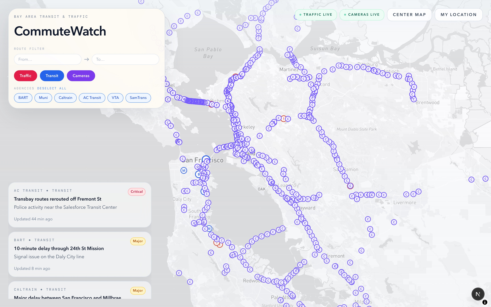
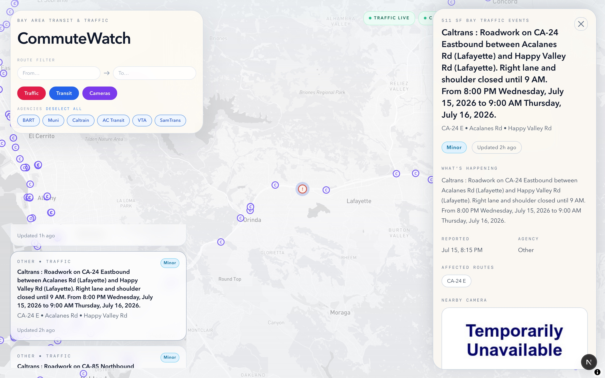
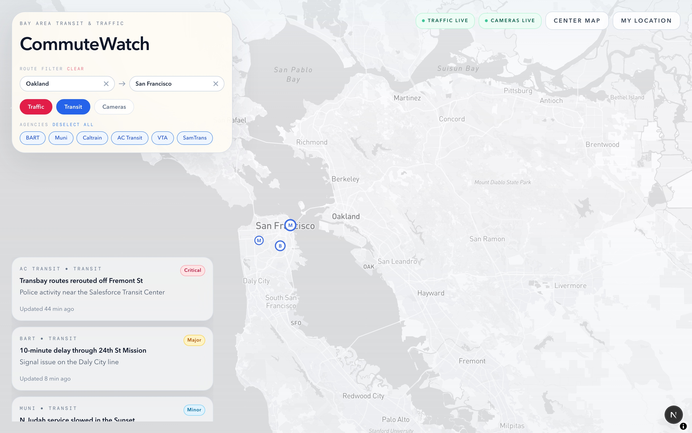

# Onramp

A map-first Bay Area commute watcher: live traffic incidents, transit service alerts, and freeway cameras on one map, with a route filter that flags what actually sits on your commute. Built twice on one data layer, as a Next.js web app and a native SwiftUI iOS client.



## What it does

It pulls live Bay Area traffic incidents (511), transit service alerts by agency (511), and freeway CCTV cameras (Caltrans) onto a single Mapbox map, each tagged with a severity. You can filter by layer (traffic, transit, cameras) and by transit agency, open any incident for its full detail plus the nearest camera, and enter a From and To to see which incidents fall on your commute corridor. Every source reports its own status (live, partial, or fallback), and with no API keys at all the app still runs end to end on bundled sample data.

## Why I built it

I check a few different sites before leaving: one for traffic, one for BART or Muni alerts, a camera page to eyeball a bridge. I wanted them on one map, scoped to the Bay Area, that could tell me whether a given mess was actually on my way. Building it turned into a lesson in how messy "just read the JSON feed" can get.

## Data sources

Keys are optional. Without them the app serves bundled sample data and labels each source as fallback.

| Source | What it provides | API key | Notes |
|---|---|---|---|
| [511 SF Bay Transit Service Alerts](https://511.org/open-data/transit) (`api.511.org/transit/servicealerts`) | Regional transit service alerts, delivered as GTFS-Realtime translated to JSON | Free 511 token | The subject of the story below |
| [511 SF Bay Traffic Events](https://511.org/open-data/traffic) (`api.511.org/traffic/events`) | Active traffic incidents in Open511 JSON | Free 511 token | |
| [Caltrans District 4 CCTV](https://cwwp2.dot.ca.gov/documentation/mtr/cctv.htm) (`cwwp2.dot.ca.gov/data`) | Freeway camera locations and snapshot image URLs | No | Camera images are frequently offline; the UI shows a placeholder |
| [Mapbox](https://docs.mapbox.com/) (`api.mapbox.com`) | Basemap tiles, geocoding, and directions | Public `pk.` token | Ships in the client bundle by design; restrict it by domain |

## The interesting problem

**What I expected.** The 511 transit service-alerts endpoint returns JSON, so I assumed I would read something like `alerts[]` with `title`, `description`, `agency`, and `routes`, plot each one, and move on.

**What it actually did.** Alerts kept silently disappearing from the map. No errors, just fewer alerts than 511's own site showed. Reading the raw responses field by field, instead of trusting the field names, turned up several reasons at once:

- The payload was not a flat array. Sometimes it was `{ entity: [{ id, alert: {...} }] }` (the real GTFS-Realtime shape), sometimes `{ alerts: [...] }`, sometimes a bare array.
- Field names were inconsistent across records: `headerText` vs `header_text`, `informedEntities` vs `informed_entities` vs `informedEntity`.
- Human-readable text was not a string. It was wrapped in GTFS-Realtime translation objects, `{ translation: [{ text, language }] }`.
- Agencies came through as cryptic operator codes (`BA`, `SF`, `CT`) rather than names.
- Many alerts had no coordinates at all, because a service alert is scoped to a route or a whole system, not a point on a map.

My original parser assumed one clean shape, so any record that did not match it got dropped on the floor. That was the silent disappearance.

**What I decided to do.** I wrote one defensive normalizer (`services/transit-alerts-service.ts`) that stops assuming and starts coping:

- `extractTransitEntities` accepts all three payload shapes and flattens them to a common list.
- `normalizeTransitEntity` tries every field-name variant, unwraps the `translation` objects to plain text, and maps the two-letter operator codes to real agency names.
- When an alert has no id, it synthesizes a stable one from agency, title, and coordinates, so duplicates across shapes collapse via `uniqueBy`.
- When an alert has no coordinates, it infers an approximate location from landmark keywords in the text and falls back to an agency-default point (`lib/geo.ts`), so route-scoped alerts still land somewhere sensible on the map.
- If a feed fails or returns nothing usable, the source degrades to bundled sample data and reports itself as `partial` or `fallback` through a status pill, so the map never silently shows nothing.

**What I chose not to do.** I did not hard-code to a single payload shape, I did not drop records that failed to match an expected schema (that was the original bug), and I did not fabricate precise coordinates for alerts that genuinely have none.

## Running it locally

**Web app** (requires Node 18.19+):

```bash
cd Web
npm install
npm run dev
```

Then open **http://localhost:3000**. Copy `Web/.env.example` to `Web/.env.local` and add a Mapbox token and a 511 key to enable live data; without them the app runs on sample data.

**iOS app** (requires Xcode): open `iOS/CommuteWatch.xcodeproj`, pick an iPhone simulator, and run. In the simulator it defaults to the web backend at `http://localhost:3000`, and falls back to bundled sample data if that backend is not running. See `iOS/README.md` for details.

## Architecture

- **The data layer is the Next.js app.** Its `app/api/*` routes fetch the 511, Caltrans, and Mapbox feeds server-side, normalize them into one domain model (incidents, transit alerts, cameras, with live/partial/fallback status), and keep the 511 key server-side. Only the public Mapbox token reaches the browser.
- **Two clients, one contract.** The Next.js frontend (Mapbox GL) and the SwiftUI iOS client (MapKit) both consume the same `/api/*` routes and decode the same response shapes, so the product behaves consistently across web and native.
- **Sample-data fallback everywhere.** Both the web routes and the iOS app ship sample fixtures, so the whole thing is runnable with no keys and no network.

## Known limitations

- **Without keys it is sample data, not live.** That keeps the project runnable for anyone, but the bundled alerts are illustrative.
- **The transit normalizer is defensive, not exhaustive.** It handles the payload shapes and field variants I actually observed from 511. A brand new shape would fall back rather than crash, but it would not be parsed.
- **Alert coordinates are inferred.** Because service alerts are route-scoped, their map position comes from landmark keywords plus agency-default points. It is approximate by nature.
- **The fetch layer has a timeout but no retry or backoff.** A slow or rate-limited 511 response just falls back to sample data rather than retrying.
- **Caltrans camera images are often offline.** The app shows a "temporarily unavailable" placeholder rather than a broken image.
- **The iOS client is a foundation.** It mirrors the web architecture and is wired to the same backend, but some flows (a fully live repository, route editing) are still sample-backed. Its README lists the remaining work honestly.
- **Local and single-user.** The Mapbox token ships in the client bundle (a public token, so restrict it by domain), and there is no hosted deployment here.

## Screenshots

Open any incident for its full 511 detail, affected routes, and the nearest camera:



Enter a From and To to filter the map to your commute corridor:



The iOS client is a native SwiftUI app (MapKit) built on the same API and domain model; it is not shown here because it needs Xcode and a simulator to run.
